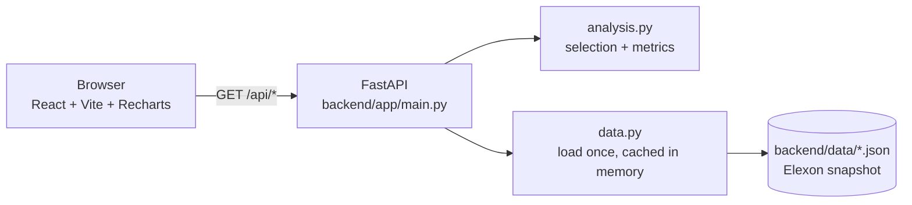

# Wind Forecast Monitor

A dashboard for a UK energy utility that buys power on the GB day-ahead market to cover shortfalls in wind generation. It answers two questions using Elexon BMRS data for January 2026:

1. **What was the latest national wind forecast available when the buying decision was made?**
2. **How accurate are these forecasts, and how does accuracy change with lead time?**

The stack is a React (Vite + Recharts) frontend and a Python FastAPI backend. It is deployed on Vercel and can also run as a single Docker container.

## Live app

- App: https://wfx7k2.vercel.app
- API health: https://wfx7k2.vercel.app/api/health (returns `{"status":"ok","actuals":1488,"forecast_rows":19856}`)

## The two client questions

| Question | How the app answers it |
|---|---|
| **1. Which forecast did I have at decision time?** | **Decision time** mode (the default). For each delivery day D, the app takes the latest forecast run published at or before gate closure on D−1, UK time; the default is 09:20 and it can be changed. Every hour of D uses that one run. A *Decision snapshot* card shows which run was used, its lead time, and forecast vs actual wind energy. The chart tooltip shows each hour's publish time and lead time. |
| **2. How accurate are the forecasts?** | **Fixed horizon** mode (0–40 h slider, quick picks 4 / 24 / 36 h) plus accuracy views: KPI cards (MAE, bias, RMSE, P90 absolute error, worst shortfall), an error histogram, MAE by hour of day, and a horizon curve of MAE / RMSE / bias against lead time. A planning panel turns the error percentiles into an expected and a cautious wind level. |

## Data

| Dataset | What it is | Rows in the snapshot |
|---|---|---|
| **FUELHH**, `fuelType = WIND` | Actual national wind generation (MW), half-hourly, 1–31 Jan 2026 | 1,488 (31 days × 48) |
| **WINDFOR** | Wind generation forecasts (MW), hourly target times, each row with a `publishTime` | 19,856 rows from 272 forecast runs |

- **One snapshot, committed to the repo.** The data was fetched once by `backend/scripts/fetch_data.py` and committed as `backend/data/actuals.json` and `backend/data/forecasts.json`. The app never calls Elexon at runtime. This keeps responses fast, means the demo doesn't depend on a third-party API being up, and makes the results (and the regression tests) reproducible.
- **Forecast lookback.** Forecasts are fetched by publish time from **29 Dec 2025 00:00 UTC** up to 1 Feb 2026, so even the first hours of 1 January have forecasts published up to about 2 days earlier.
- **How often forecasts come out.** WINDFOR runs are published 8 times a day at :30 past the hour (02:30, 04:30, 07:30, 09:30, 11:30, 15:30, 18:30, 22:30 UTC in this snapshot), 2–4 h apart. On one day a 12:25 run replaces the 11:30 one.
- **Cleaning in the fetch script.**
  - FUELHH: if a half-hour was re-published, the version with the latest `publishTime` is kept.
  - WINDFOR: rows are de-duplicated on (`publishTime`, `startTime`).

## Method

All logic is in [`backend/app/analysis.py`](backend/app/analysis.py), as pure functions.

### Fixed-horizon rule

For a target hour **T** and horizon **H**, the app uses the **latest forecast with `publishTime ≤ T − H`**.

*Worked example.* Suppose the target is 2 Jan 12:00 and runs were published at 1 Jan 00:00, 1 Jan 12:00 and 2 Jan 06:00:

| H | Cutoff (T − H) | Run used |
|---|---|---|
| 4 h | 2 Jan 08:00 | 2 Jan 06:00 |
| 12 h | 2 Jan 00:00 | 1 Jan 12:00 |
| 24 h | 1 Jan 12:00 | 1 Jan 12:00 (a run published exactly at the cutoff counts) |
| 30 h | 1 Jan 06:00 | 1 Jan 00:00 |

### Decision-time rule

For a target hour on UK delivery day **D**, the app uses the **latest run published at or before gate closure on D−1**, interpreted in **Europe/London** time and converted to UTC (`zoneinfo` + `tzdata`).

- The default gate closure is **09:20** (`DEFAULT_GATE_CLOSURE` in [`backend/app/main.py`](backend/app/main.py)). This is a **configurable assumption to confirm with the client's trading desk**. Users can change it in the UI or with the `gate_closure` API parameter.
- In January, a 09:20 gate closure selects the **07:30 UTC run on D−1** for every day; the 09:30 run comes out too late. Lead times are then 16.5 h (00:00) to 39.5 h (23:00).

### Lead time is longer than H

Runs come out every 2–4 h, so the run used at horizon H was published **H + 0.5 h to H + 3.5 h** before delivery. For example, at H = 24 the lead is 24.5–27.5 h. The API returns `leadHours` for every row, and the tooltip shows it.

### Matching half-hourly actuals to hourly forecasts

Forecasts exist only for on-the-hour target times. Comparisons therefore use the **on-the-hour half-hour actuals only, which gives 744 hours in January**. The `:30` actuals are still returned and plotted, but have `forecast = null` and are left out of every metric.

### Horizon capped at 40 h

Every on-the-hour January hour has a forecast at every horizon from 0 to 43 h. From 44 h, some hours have none (31 missing at 44 h, more beyond). Above that point each horizon would be averaged over a different set of hours, which would make the horizon curve misleading. So `MAX_HORIZON_HOURS = 40`, and the API rejects larger values.

### Error sign

**error = actual − forecast**. A negative error means wind came in **below** forecast, which is the shortfall the buyer has to cover.

### Metrics

Metrics are computed over matched hours only (`compute_metrics`):

| Metric | Definition |
|---|---|
| MAE | Mean of the absolute error |
| RMSE | √(mean of error²); gives more weight to large misses |
| Bias | Mean error (actual − forecast); negative = forecasts too high on average |
| nMAE | MAE ÷ mean actual output × 100. Relative to **mean output, not capacity** |
| P10 / P50 / P90 | Percentiles of the signed error (linear interpolation) |
| P90 absolute error | 90% of hours had an absolute error at or below this |
| Worst shortfall / surplus | Minimum / maximum error |
| MAE by hour | MAE grouped by UTC hour of day (UTC = UK time in January) |
| Error histogram | Hour counts in 1,000 MW bins of signed error (floor binning, so −1 falls in [−1000, 0)) |
| Horizon curve | MAE, RMSE, bias and P10 at horizons 0, 2, …, 40 h for the selected dates |

## Key findings (January 2026, all 744 matched hours)

| View | MAE | RMSE | Bias | nMAE |
|---|---|---|---|---|
| Fixed horizon 0 h | 1,794 MW | 2,281 MW | −1,592 MW | 15.5% |
| Fixed horizon 24 h | **2,050 MW** | 2,518 MW | **−1,854 MW** | 17.7% |
| Fixed horizon 40 h | 2,297 MW | 2,810 MW | −1,954 MW | 19.8% |
| Decision time, 09:20 gate closure | **2,127 MW** | 2,606 MW | **−1,852 MW** | 18.4% |

Mean actual output over these hours was 11,581 MW.

- **Errors grow with lead time:** MAE rises from about 1.8 GW at 0 h to about 2.3 GW at 40 h.
- **Decision time is slightly worse than a fixed 24 h horizon** (2.13 vs 2.05 GW MAE). A buyer at 09:20 on D−1 is really working with forecasts made 16.5–39.5 h ahead, not a flat 24 h.
- **Energy view (decision mode, 09:20).** Summed over the 744 matched hours, the forecast was about **9,994 GWh** and the actual about **8,616 GWh**, i.e. **about −14%** (−13.8%).
- **The bias persists even at 0 h** (−1.59 GW, for forecasts published 0.5–3.5 h ahead). This is an observation from the data, not a proven cause. It suggests the two datasets don't measure exactly the same thing, for example curtailed wind or a different set of wind farms. It is probably not only forecast skill. The dashboard shows this as a note and treats the bias as a systematic adjustment.

## Architecture



- The data is loaded once per process (`functools.lru_cache`) into a `ForecastIndex`: for each target time, its runs sorted by publish time. A selection is then a binary search (`bisect_right`).
- The frontend calls only same-origin `/api/...` URLs. `VITE_API_BASE` can point the frontend at a different backend if needed.

### On Vercel

How [`vercel.json`](vercel.json) handles requests:

- **`"framework": null`** sets the project preset to "Other". Without it, Vercel can detect FastAPI from `requirements.txt` and apply its Python framework preset. That preset takes precedence over file-based `/api` functions, and it doesn't look for an entrypoint in `api/`.
- **Build:** `cd frontend && npm ci && npm run build`. The output directory is `frontend/dist`.
- **Function:** [`api/index.py`](api/index.py) adds `backend/` to `sys.path` and exports the FastAPI `app`.
  - `includeFiles: backend/{app,data}/**` adds the app code and data to the function bundle.
  - `excludeFiles` keeps `frontend/**`, tests, scripts and any local `.venv` out of it.
- **Routing:** static files are checked before rewrites.
  - `/` and `/assets/*.js|css` are served directly from `frontend/dist`.
  - `/api/(.*)` is rewritten to the Python function, which receives the original path (e.g. `/api/metrics`).
  - Any other path except `api/` and `assets/` falls back to `/index.html` (SPA fallback), so a missing asset returns a real 404.
- [`.vercelignore`](.vercelignore) keeps local `.venv`, caches, `node_modules`, `dist`, tests and scripts out of the upload.

### In Docker

[`Dockerfile`](Dockerfile):

1. Stage 1 (`node:22-alpine`): `npm ci` and `npm run build`.
2. Stage 2 (`python:3.12-slim`): installs `backend/requirements.txt`, copies `backend/` and the built frontend to `/app/static`, and sets `STATIC_DIR`. FastAPI then mounts the frontend at `/` after the `/api` routes, so **one process on port 8000 serves both the API and the frontend**.
3. The app runs as a non-root user (`app`, uid 10001). A `HEALTHCHECK` calls `/api/health` with Python's `urllib`.

## Project structure

```
.
├── api/
│   └── index.py              Vercel entry point: puts backend/ on sys.path, exports the FastAPI app
├── backend/
│   ├── app/
│   │   ├── analysis.py       Forecast selection (fixed horizon, decision time), metrics, histogram, horizon curve
│   │   ├── data.py           Loads the JSON snapshot once and builds the ForecastIndex
│   │   └── main.py           FastAPI routes, input validation, gate-closure default, static mount for Docker
│   ├── data/
│   │   ├── actuals.json      FUELHH wind actuals, half-hourly, January 2026
│   │   └── forecasts.json    WINDFOR forecasts with publishTime, published 29 Dec 2025 – 31 Jan 2026
│   ├── scripts/
│   │   └── fetch_data.py     One-off download of both datasets from the Elexon BMRS API
│   ├── tests/
│   │   ├── conftest.py       Shared fixtures (TestClient, real data; skips if the data files are missing)
│   │   ├── test_analysis.py  Pure-function tests for selection, metrics, histogram, percentiles, decision time
│   │   ├── test_api.py       Endpoint validation and responses via FastAPI TestClient
│   │   └── test_real_data.py Coverage, brute-force selection check and regression values on the snapshot
│   ├── pytest.ini            Test discovery, import path, warning filter
│   ├── requirements.txt      Runtime deps for Docker/local (pinned)
│   └── requirements-dev.txt  Test deps (pinned)
├── frontend/
│   ├── index.html            Page shell, title, IBM Plex Sans from Google Fonts
│   ├── vite.config.js        Dev server proxy: /api → http://127.0.0.1:8000
│   ├── package.json / package-lock.json
│   ├── public/favicon.svg
│   └── src/
│       ├── main.jsx          React entry
│       ├── App.jsx           Page layout, filter state, data fetching, loading/error states
│       ├── api.js            API calls and display helpers (GW formatting, mode description)
│       ├── index.css         Theme tokens (light/dark), base typography
│       ├── App.css           Layout, cards, controls, KPI and snapshot styles
│       └── components/
│           ├── Controls.jsx         Period, mode switch, gate-closure time or horizon slider + quick picks
│           ├── DecisionSnapshot.jsx Run used, lead time, forecast vs actual energy (decision mode)
│           ├── KpiCards.jsx         MAE, bias, RMSE, P90 absolute error, worst shortfall
│           ├── BiasNote.jsx         Note shown when |bias| > 500 MW
│           ├── ForecastChart.jsx    Actual vs forecast time series with publish/lead-time tooltip
│           ├── PlanningPanel.jsx    Expected and cautious wind levels from error percentiles
│           ├── ErrorCharts.jsx      Error histogram and MAE by hour of day
│           ├── HorizonChart.jsx     MAE/RMSE/bias vs horizon, selected horizon or decision-time lead band
│           └── chartStyles.js       Shared tooltip/axis styles and round-tick helper
├── vercel.json               Vercel build, function bundle and routing
├── .vercelignore             Files never uploaded to Vercel
├── .python-version           Python 3.12 for Vercel
├── requirements.txt          Python deps for the Vercel function (pinned)
├── Dockerfile                Two-stage build: frontend, then Python API serving it
├── docker-compose.yml        Runs the image on port 8000
└── .dockerignore / .gitignore
```

## API reference

All endpoints are `GET`. Dates are calendar days in UTC.

| Endpoint | Query parameters | Returns |
|---|---|---|
| `/api/health` | none | `{"status": "ok", "actuals": 1488, "forecast_rows": 19856}` |
| `/api/meta` | none | `{"first_day": "2026-01-01", "last_day": "2026-01-31", "default_horizon": 24, "max_horizon": 40, "default_gate_closure": "09:20", "unit": "MW"}` |
| `/api/series` | `start`, `end`, `horizon`, `gate_closure` | One row per half-hour in the period (see below) |
| `/api/metrics` | `start`, `end`, `horizon`, `gate_closure` | Metrics object (see below), or `{"count": 0}` if no hours matched |
| `/api/horizon-curve` | `start`, `end` | `[{"horizon": 0, "mae", "rmse", "bias", "error_p10", "count"}, …]` for horizons 0, 2, …, 40 |

**Parameters and validation**
- `start`, `end`: `YYYY-MM-DD`, default `2026-01-01` and `2026-01-31`. The window is from 00:00 UTC on `start` up to (not including) 00:00 UTC the day after `end`.
  - If `start` is after `end`, the response is **400** "start must be on or before end".
  - Dates outside 1–31 January give **400** "dates must be between …".
  - A malformed date gives **422**.
- `horizon`: a number of hours, default 24, must be **0–40** (decimals allowed). Out of range or non-numeric gives **422**.
- `gate_closure`: optional, `HH:MM` 24-hour UK time, matching `^([01]\d|2[0-3]):[0-5]\d$`, so `09:20` is valid and `9:20` is not. Invalid values give **422**.
  - **If `gate_closure` is given, decision-time selection is used and `horizon` is ignored.** Otherwise the fixed-horizon rule applies.

**`/api/series` rows** (real values: 15 Jan, `gate_closure=09:20`)
```json
[{"time": "2026-01-15T12:00:00Z", "actual": 9742, "forecast": 11049,
  "publishTime": "2026-01-14T07:30:00Z", "leadHours": 28.5, "error": -1307},
 {"time": "2026-01-15T12:30:00Z", "actual": 9839, "forecast": null,
  "publishTime": null, "leadHours": null, "error": null}]
```
`:30` rows and hours with no forecast have `forecast`, `publishTime`, `leadHours` and `error` set to `null`.

**`/api/metrics` object**
```json
{"count": 744, "mae": 2050, "rmse": 2518, "bias": -1854, "nmae_pct": 17.7, "actual_mean": 11581,
 "error_p10": -4129, "error_p50": -1709, "error_p90": 288, "abs_error_p90": 4129,
 "max_shortfall": -6804, "max_surplus": 2655,
 "mae_by_hour": [{"hour": 0, "mae": 2240}, …],
 "error_histogram": [{"from": -7000, "to": -6000, "count": 11}, …]}
```
(January, `horizon=24`.) All values are in MW, rounded to whole MW; `nmae_pct` is rounded to 0.1.

## Running locally

You need Python 3.12 and Node 22 (the versions used in the Dockerfile).

**Backend**   (from the repo root):

```powershell
# Windows PowerShell
cd backend
py -3.12 -m venv .venv
.venv\Scripts\Activate.ps1
pip install -r requirements.txt -r requirements-dev.txt
uvicorn app.main:app --reload --port 8000
```

```bash
# macOS / Linux
cd backend
python3.12 -m venv .venv
source .venv/bin/activate
pip install -r requirements.txt -r requirements-dev.txt
uvicorn app.main:app --reload --port 8000
```

**Frontend** (second terminal, from the repo root). The commands are the same on every OS:

```bash
cd frontend
npm install
npm run dev
```

Open the URL Vite prints (by default http://localhost:5173). Vite forwards `/api` requests to the backend on port 8000.

**Refreshing the data** (optional; overwrites `backend/data/*.json`). From `backend/` with the venv active:

```bash
python scripts/fetch_data.py
```

## Running with Docker

```bash
docker compose up --build
```

Then open http://localhost:8000. The API is at http://localhost:8000/api/health.

## Tests

From `backend/` with the venv active:

```bash
pytest
```

`pytest.ini` sets the test path, the import path and a warning filter, so no extra flags are needed. The suite has **107 tests** and runs in about a second:

- **`test_analysis.py` (26):**
  - Fixed-horizon selection, including a run exactly at the cutoff, fractional horizons, forecasts published after the target (never used, even at 0 h), hours with no forecast, and `:30` actuals excluded.
  - The date window boundaries.
  - Metrics against hand-calculated values (MAE, RMSE, bias, nMAE, percentiles, by-hour, histogram), histogram bin edges, and percentile edge cases.
  - The horizon curve skipping empty horizons.
  - UK-time gate closure, including a summer-time case; one run per delivery day; a run exactly at gate closure counts, one minute later doesn't.
- **`test_api.py` (36):**
  - `/api/health` and `/api/meta`.
  - 400s for bad date ranges; 422s for bad `horizon` and `gate_closure` values.
  - Valid fixed-horizon and decision-time requests, and `gate_closure` overriding `horizon`.
- **`test_real_data.py` (45):**
  - All 744 hours have a forecast at every horizon 0–40.
  - A brute-force check: the selected run is the latest with `publishTime ≤ T − H`, and lead ≥ H.
  - Decision time uses exactly one run per day.
  - **Regression values:** MAE 2,050 / bias −1,854 at 24 h; MAE 2,127 / bias −1,852 at 09:20.
  - These tests skip cleanly if the data files are missing.

## Deployment (Vercel)

1. Import the Git repository in Vercel. Keep the root directory as the repo root and choose **Application Preset: Other**. `vercel.json` sets `"framework": null` anyway and drives the build, output directory, function and routing.
2. No environment variables are required.
3. **Versions are pinned for reproducible builds:**
   - `requirements.txt` (Vercel function): `fastapi==0.162.0`, `tzdata==2026.5`.
   - `backend/requirements.txt` (Docker/local): adds `uvicorn==0.54.0` and `httpx==0.28.1`.
   - `backend/requirements-dev.txt`: `pytest==9.1.1`, `httpx==0.28.1`.
   - The frontend is locked by `package-lock.json` and installed with `npm ci`.
4. `.python-version` (`3.12`) fixes the Python version Vercel uses.
5. After deploying, check `/api/health` and `/api/metrics?horizon=24` (count 744, MAE 2050).

## Assumptions and limitations

- **January 2026 only**, from a **static snapshot**; there is no live refresh.
- **Date windows and displayed times are UTC.** That is correct for January, when UTC equals UK time. In British Summer Time, a UK delivery day would cross two UTC dates. The decision-time cutoff already uses Europe/London.
- **The gate closure time (09:20) is an assumption** and should be confirmed with the trading desk.
- **Bias interpretation:** the persistent negative bias is an observation. Its cause (curtailment, different wind-farm coverage between datasets, or forecast skill) is not established.
- **National wind only.** There is no regional breakdown, no demand data, and no prices.
- The planning panel's percentiles are computed over the whole selected period, not conditioned on the forecast level.
- **No authentication.** The API is public, read-only, and allows CORS from any origin for `GET`.

## Future improvements

- A scheduled data refresh (e.g. a Vercel cron job or a webhook) that fetches new Elexon data, instead of a fixed snapshot.
- A per-hour buffer that depends on the forecast level, rather than one month-wide percentile offset.
- More months and seasons, with full British Summer Time handling of day windows.
- Integration with the client's demand data, to turn wind error into a volume to buy.
- Code-splitting the frontend: the production JS bundle is about 630 kB.

## AI tools used

AI tools were used in this project:
- **Claude (chat)** for planning, domain research and guidance.
- **Claude Code** for code review, implementing changes, and writing tests and documentation.

All design decisions and results were reviewed and verified by the author, **Mohd Shahid Khan**.
